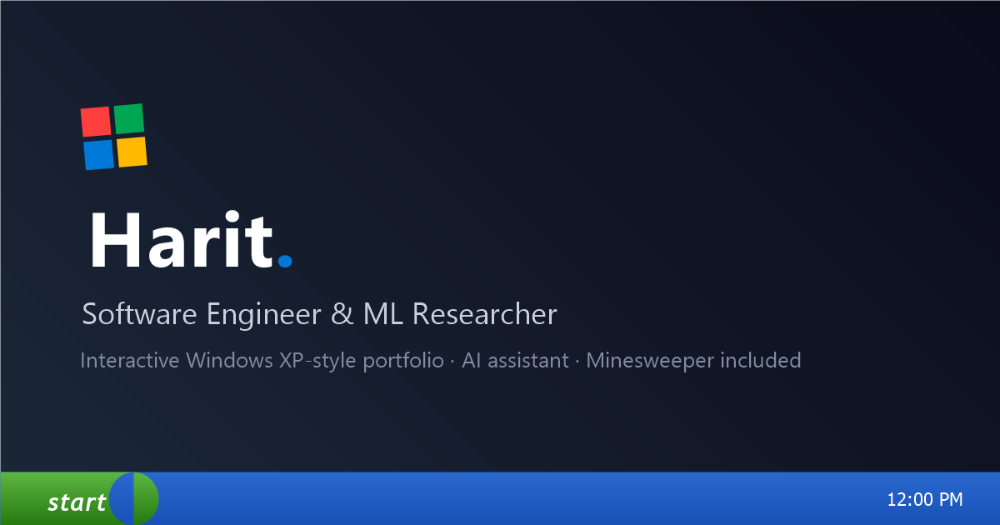

# HaritOS XP



An interactive Windows XP-themed portfolio website with a dual-mode interface: a clean modern portfolio for quick browsing and a full XP desktop experience with 10+ apps, an AI assistant, and Minesweeper.

Built with React + Vite. All code is original — no assets or code from any other project were used.

## Quick Start

```bash
npm install
cp .env.example .env   # Add your Groq API key for HaritBot
npm run dev             # http://localhost:3000
```

## Features

**Dual-Mode Interface**
- Landing page with Quick View (~30s) and Full XP Experience (~5min) options
- Fully responsive — both modes work on phones and tablets. In XP mode, apps open full screen, desktop icons re-grid, the taskbar adapts, and everything is touch-draggable
- URL hash routing (`#quick`, `#xp`) for deep linking
- Seamless switching: Log Off → Quick View, Shut Down → Landing (with animation)

**XP Desktop**
- BIOS boot sequence → branded loading screen → welcome dialog
- Draggable, resizable windows with Luna Blue chrome and open/close animations
- Start menu, taskbar with window tabs, system tray with clock
- Desktop icons, right-click context menu
- Three themes via terminal: `theme blue`, `theme silver`, `theme olive`

**Apps**
| App | Description |
|-----|-------------|
| 👤 About Me | Profile card with XP-style sidebar |
| 📄 Resume Viewer | PDF reader-style display with working Print button |
| 📁 Project Explorer | IE-style browser with tile/detail views |
| ⚙️ Skills | Control Panel-style skill categories |
| ✉️ Contact | Outlook Express email compose with reveal flow |
| 🤖 HaritBot | AI assistant powered by Groq (Llama 3.3) with full RAG context |
| 💻 Terminal | Interactive shell with 15+ commands, arrow-key history |
| 🌐 Internet Explorer | Embed live project demos via iframe |
| 🐟 Finfolk.exe | The Finfolk evolution simulation (C++ → WebAssembly) in a window, with an "Open full version" link. On phones it describes the demo and opens it full screen instead (or runs it in the window on request) |
| 📝 Notepad | Editable text app |
| 💣 Minesweeper | Working 9×9 game with timer and flag counter |

**Easter Eggs**
- Clippy appears after 12s with hiring-related quips
- MSN Messenger notification after 18s
- Terminal commands: `neofetch`, `sudo`, `fortune`, `theme`

**Performance**
- Code-split into 21 lazy-loaded chunks (54KB initial load)
- React.memo on window wrappers to prevent cascade re-renders
- Error boundaries per window — one crashed app won't kill the desktop
- XP chunks prefetch while user is on the landing page

**Mobile / Responsive**
- `dvh`-based viewport sizing — the taskbar stays visible as the mobile URL bar collapses
- Windows auto-maximize on phones and clamp to the viewport on tablets/small laptops
- Desktop icons auto-arrange into a grid on small screens and reflow on rotation
- Long-press (or 🚩 mode) to flag in Minesweeper; 16px inputs to prevent iOS focus zoom
- Clippy and the MSN popup wait while a window is open on a phone, instead of covering it
- Projects with a live demo get a "▶ Try it live" link in Quick View and a "Run the live demo" button in My Projects (shown once the demo URL is set)

## Configuration

All personal data lives in one file: `src/data/resume-data.js`

Update these `// TODO` fields before deploying:
- `personalInfo.email`
- `personalInfo.github`
- `personalInfo.linkedin`
- `personalInfo.website`
- `og:url` in `index.html`

### HaritBot (AI Assistant)

1. Get a free API key at [console.groq.com](https://console.groq.com)
2. **Production (Vercel):** set `GROQ_API_KEY` as an environment variable. The `api/chat.js` serverless proxy keeps the key server-side, owns the system prompt, and rate-limits per IP (30 req/hour via Redis, fail-open without it). `VITE_GROQ_API_KEY` is also accepted for backwards compatibility.
3. **Local dev:** add `VITE_GROQ_API_KEY` to `.env` — `npm run dev` then calls Groq directly. This dev-only path (and the key) is eliminated from production bundles.
4. The bot has full context of your resume data and answers recruiter questions

### Embedding Live Projects

Edit `src/apps/InternetExplorer.jsx` — add deployed URLs to the `BOOKMARKS` array.

`src/apps/EvoBoids.jsx` embeds the Finfolk demo (formerly evo_boids) from its own Vercel project, https://finfolk-sim.vercel.app/ (formerly https://evo-boids.vercel.app/, which still works). The URL is `EVOBOIDS_URL` in `src/data/demo-urls.js`, shared with the Internet Explorer bookmark and the projects' "Try it" links. The `VITE_EVOBOIDS_URL` environment variable overrides it, for example to test a local build. If it is ever set to empty, the window and the bookmark show "coming soon". Inside the iframe the demo runs its single-threaded build, because this site does not send the cross-origin-isolation headers (COOP/COEP) that its threaded build needs, and adding them would break the other embeds. "Open full version" opens it in a new tab, where it gets them.

### Visitor Map: owner key, bots, flags

The 🔑 button in the Visitor Map's header takes the owner key (Vercel env `OWNER_KEY`). The server checks it and allows five wrong tries per IP per hour. Once unlocked, that browser takes back the one visit it was counted for and is never counted again: no map visit, no GA4 or Vercel Analytics events, and later no blog views. "Turn off" forgets the key. The visits API also ignores crawlers that run JavaScript (Googlebot, headless Chrome, link previewers).

Windows has no flag emoji, so Chrome and Edge there show "US" instead of 🇺🇸. `main.jsx` loads [country-flag-emoji-polyfill](https://github.com/talkjs/country-flag-emoji-polyfill) with its font bundled from npm (no CDN), only on browsers that need it. The flag glyphs are [Twemoji](https://github.com/jdecked/twemoji) (CC-BY 4.0).

### Blog (/blog)

The blog is a separate static site in `blog/` (Astro), built into `dist/blog` after the XP app and served by the same Vercel project at `/blog/`. The 📰 **My Blog** icon and Start menu entry open it in an XP window, Quick View links to it, and every post has its own URL with link-preview tags and an RSS feed at `/blog/rss.xml`.

- **Writing.** Posts are Markdown files in `blog/src/content/posts`, edited with [Pages CMS](https://pagescms.org): sign in at app.pagescms.org with GitHub and open this repo (the fields are set in `.pages.yml`). New posts start as drafts. Untick **Draft** to publish. Every save is a commit to `main`, so Vercel deploys it in about a minute. Images go to `blog/public/media`. A post can have a tier list (S to F rows), drawn above the text.
- **Comments.** No login: a name and a comment. Plain comments show at once. Comments with links, or names containing "Harit", wait for approval. The rate limit is three comments per 10 minutes and 20 per day per visitor, with a hidden honeypot field for bots. Moderate at `/blog/moderate/` with the owner key (approve, hide, delete). With the owner key, your own comments show an Author badge.
- **Views.** One view per visitor per post per day, deduped by a salted hash that expires (raw IPs are never stored). Crawlers and owner-mode browsers don't count.
- **API.** `api/blog.js` stores views and comments in the same Redis as the visitor map, under `blog:*` keys. Tests: `test/blog-api.test.js`.
- **Local.** `npm run dev:blog` serves the blog with drafts at http://localhost:4321/blog/ (comments and views need the API, so they show as unavailable there). `npm run build && npm run preview` serves both sites together. `BLOG_DRAFTS=1 npm run build` includes drafts.

### Sound Effects

All UI sounds (startup chime, clicks, minimize/close, notifications) are synthesized at runtime with the Web Audio API — no audio files, and every melody is original. Silently no-ops if the browser blocks audio.

## Deployment

```bash
npm run build    # XP app into dist/, then the blog into dist/blog/
npx vercel       # Deploy to Vercel
```

`vercel.json` sets the build command and output folder, sends every path except `/blog/` and `/api/` to the XP app, and sets the iframe headers. Environment variables: `REDIS_URL` (visitor map, blog), `OWNER_KEY` (Visitor Map key button and blog moderation), `GROQ_API_KEY` (HaritBot), `VITE_CARTO_KEY` (map tiles), `VITE_GA4_MEASUREMENT_ID` (analytics).

## Project Structure

```
src/
├── App.jsx                          # Router + lazy loading orchestrator
├── data/resume-data.js              # Single source of truth for all content
├── shared/Components.jsx            # 8 reusable components (both modes use these)
├── hooks/
│   ├── useWindowManager.js          # Window state (drag, resize, z-order, min/max)
│   └── useSounds.js                 # Sound system with graceful fallback
├── components/
│   ├── LandingPage.jsx              # Mode chooser
│   ├── QuickPortfolio.jsx           # Modern single-page portfolio
│   ├── Boot/BootSequence.jsx        # BIOS → loading → welcome
│   ├── ShutdownScreen.jsx           # "Shutting down..." animation
│   ├── Desktop/Desktop.jsx          # Wallpaper, icons, context menu
│   ├── Window/Window.jsx            # XP chrome, 8 resize handles
│   ├── Taskbar/Taskbar.jsx          # Start menu, tabs, system tray
│   ├── WelcomeDialog.jsx            # First-boot tips + disclaimer
│   ├── ErrorBoundary.jsx            # Per-window crash recovery
│   ├── Clippy.jsx                   # "It looks like you're hiring!"
│   └── MSNPopup.jsx                 # "Harit is online" notification
├── apps/
│   ├── AboutMe.jsx
│   ├── ResumeViewer.jsx
│   ├── ProjectExplorer.jsx
│   ├── SkillsPanel.jsx
│   ├── ContactOutlook.jsx
│   ├── Terminal.jsx
│   ├── InternetExplorer.jsx
│   ├── EvoBoids.jsx
│   ├── AIAssistant.jsx
│   ├── Notepad.jsx
│   └── Minesweeper.jsx
└── styles/
    ├── xp-theme.css                 # Luna Blue CSS variables
    ├── animations.css               # All keyframes (consolidated)
    └── print.css                    # Print stylesheet for resume
```

## Disclaimer

This project is a work of parody intended for educational and portfolio purposes. It is an original implementation that evokes a classic operating system aesthetic for the web.

The visual design language of Windows XP, including the Luna theme, is the intellectual property of **Microsoft Corporation**. This project uses no actual Microsoft assets — all visuals are original CSS approximations. No ownership of Microsoft's design language is claimed.

The concept of an OS-themed portfolio is a well-established genre in web development. This project was directly inspired by [Mitch Ivin's XP portfolio](https://mitchivin.com/). All code is original.

## License

[MIT](LICENSE)
